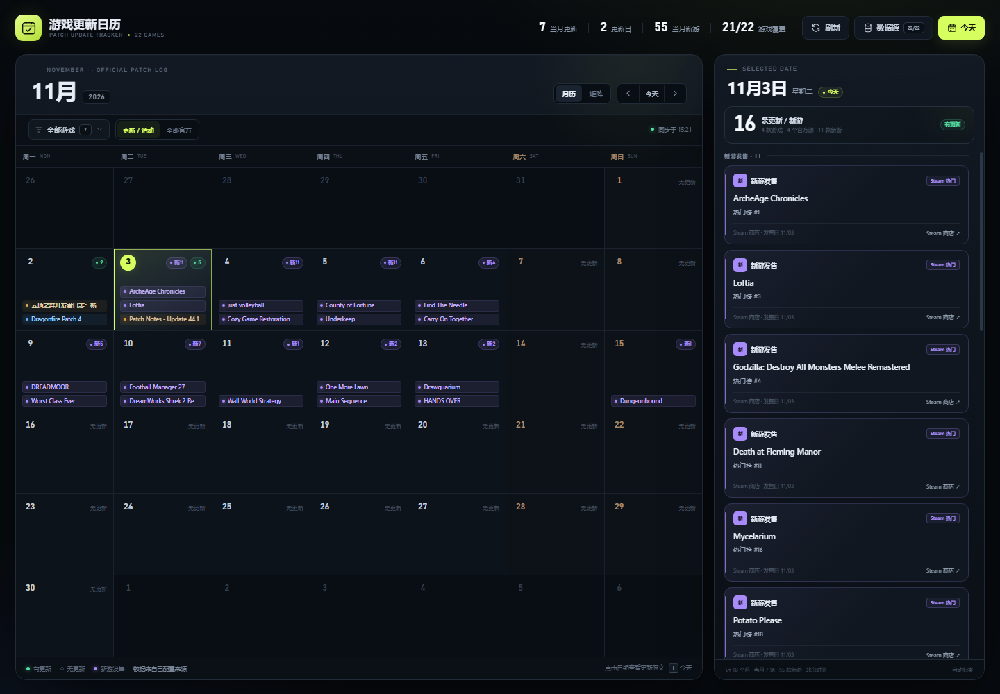

# 游戏更新日历 · Official Patch Tracker

一个会自动从官方 / 社区更新源汇总 22 款游戏每天更新内容的日历。它不再依赖手动勾选：服务端读取已配置 API / 新闻页，网页按北京时间把标题、日期和原文链接落到月历上。

> **在线预览（静态快照）**：<https://zhuzeyv.github.io/game-update-calendar/>
> 这是 `docs/` 里的只读快照，只用于看界面；要自动同步请本地跑 `server.py`。
> 重新生成快照：`python tools/build_static.py`



## 快速开始

1. 双击 `start.bat`；或在本目录运行：
   ```bash
   python server.py
   ```
2. 打开 <http://127.0.0.1:8787>。
3. 首次同步会从 22 个自动源拉取数据，通常约 1 分钟；之后每 30 分钟自动同步。
4. 右上角 **刷新** 可手动同步，**数据源** 可以查看每个游戏抓取成功/失败的原因。

`start.bat` 会优先使用本机 DSH 自带的 Python；如果不存在，则使用 PATH 中的 `python`。需要 Python 3.10+，没有第三方依赖。

## 已接入的来源

| 覆盖游戏 | 来源 |
|---|---|
| Apex、Tarkov、PUBG、战争雷霆、暗区突围、COD、彩虹六号、Albion、猎杀对决、越来越黑暗、CS2、黎明杀机、三角洲、失落的方舟 | Valve 官方 Steam Web API（`ISteamNews/GetNewsForApp`，官方公告 feed） |
| 守望先锋 2 | Blizzard 官方新闻 API（`news.blizzard.com/api/news`） |
| Valorant 特战英豪 | Riot 官方新闻页（Next.js 数据） |
| 英雄联盟 | 腾讯官方公告 API（`apps.game.qq.com`） |
| 星际战甲 Warframe | `warframe.com/news` 官方新闻页 |
| 永恒之塔 2 国际服 | NCSoft 官方公告 API（AION2 Global） |
| 永恒之塔 2 韩台服 | NCSoft 官方公告 API（韩服 + 台服两个官方板块） |
| NIKKE 胜利女神 | GameKee 社区公告（`gamekee.com/nikke/notice`，非官方 API，按需求接入） |

### 新游发售（新增）

日历里除了「更新」，还会显示**每天即将发售的游戏**，按发售日落到对应日期格上。

| 顺序 | 来源 | 说明 |
|---|---|---|
| 1 | [SteamDB upcoming](https://steamdb.info/upcoming/) | 带真实 `Follows` 数字，按 **follows > 5000** 过滤（5000 本身不显示）。SteamDB 有 Cloudflare 人机验证，普通请求会被挡，所以由本机 Chrome 渲染后读取表格 |
| 2 | Valve 官方「热门即将推出」 | `store.steampowered.com/search/results/?filter=popularcomingsoon`，只作为标题 / 日期候选。**没有 follows 数字，因此不能证明符合阈值；无真实关注度的条目一律隐藏**，绝不按热度排名代替关注度 |

SteamDB 成功时，只有真实 follows **大于**阈值的游戏才显示；SteamDB 不可用时，Steam 官方榜不会被当作达标证明，关注度未知的候选也隐藏。页面「数据源」会说明隐藏的未知关注度候选数量及 SteamDB 的失败原因。
- 每天同步时会记录每款游戏**第一次上榜的日期**；当天首次出现的会打 `NEW` 角标（第一次同步只建立基线，不会把所有游戏都标成 NEW）。
- 阈值和候选抓取数量可以用环境变量改：`RELEASE_FOLLOWS_MIN=5000`（**严格大于** 5000 才显示）、`RELEASE_POPULAR_LIMIT=60`（官方热门榜候选抓取量）、`RELEASE_WINDOW_DAYS=420`；完全关掉 SteamDB 那条路用 `RELEASE_STEAMDB=0`。
- 只保留有**确切发售日**的游戏；`Q4 2026`、`Coming soon`、`待定` 这类没有具体日期的会被跳过。
- 页面按游戏筛选时，新游会暂时隐藏（新游不属于已跟踪的 22 款游戏）。

> Steam 的官方 Web API 在部分网络会拦截 HTTPS，服务端使用其公开的 HTTP 接口（仍是官方数据），并发默认降为 1 以免被 Steam 限速；如果该接口也不可用，会回退到 `https://proxy.cors.dev/` 传输代理。Riot 的 CDN 在部分网络会重置 TLS，服务端会优先用系统 `curl` 读取官方页面，失败后再走代理。数据本身仍来自官方 URL。可通过 `STEAM_PROXY` 替换代理、`STEAM_PROXY_ONLY=1` 强制走代理、`STEAM_CONCURRENCY=2` 调整并发。

### 已按要求停用

**炉石传说**：`sources.py` 中的 Hearthstone 数据源已整段注释，不再抓取；页面仍保留游戏筛选入口，不再计入覆盖数。

### 暂未覆盖

目前没有额外未接入的游戏；NIKKE 使用 GameKee 社区整理源，不是官方 API。

## 页面能力

- **月历视图**：每天显示来自官方源的更新条数，以及最多两条更新标题；点击日期查看全部。
- **新游发售**：日期格里用紫色「新N」标出当天发售的新游，详情面板按「新游发售 / 官方更新」分组，新游卡片带 follows、7 天涨幅、价格和 `NEW` 角标。
- **游戏矩阵**：22 款游戏 × 当月日期，一眼看出哪款游戏哪一天有更新。
- **官方原文**：每张更新卡片都链接到发布方原文。
- **游戏筛选**：按游戏查看当月更新，带官方源健康状态。
- **更新范围**：默认只看“版本更新 / 活动”；切换“全部官方”可看到公告、社区、赛事等内容。
- **数据源面板**：每个源的状态、条数、最近成功时间和失败原因。
- **自动同步**：服务端每 30 分钟刷新；页面每 5 分钟检查一次，页面回到前台也会刷新。
- **北京时间归类**：所有事件按 Asia/Shanghai 日期归档。

## 数据与缓存

- 缓存：`data/cache.json`（标题、时间、摘要、官方链接；不含全文）。
- 新游缓存：`data/releases.json`（发售日、follows、7 天涨幅、首次上榜日期）。
- `data/chrome-profile/` 是读 SteamDB 用的 Chrome 配置目录（会自动创建，可随时删除，删了下次同步要重新过一次人机验证）。
- 服务默认只监听 `127.0.0.1`，不需要 API Key。
- 如果修改了 `sources.py` 或 provider，重启 `server.py` 生效。
- 选择“全部官方”会包含赛事、商城、社区等非补丁内容；默认“更新 / 活动”会过滤掉这些。

## 目录

```text
index.html          自动更新日历前端
server.py           Python 标准库 HTTP 服务 + 抓取/缓存
sources.py          22 款游戏和官方源配置
releases.py         新游发售抓取（SteamDB / Steam 热门即将推出）
browser.py          用本机 Chrome 渲染受 Cloudflare 保护的页面（CDP，纯标准库）
tests/test_releases.py  解析器自测（无需联网）
data/cache.json     最近一次成功抓取缓存
data/releases.json  新游发售缓存
start.bat           Windows 一键启动
preview.png         月历预览
preview-matrix.png  矩阵预览
```

## 限制

- 官方源标题语言由发布方决定（英文、繁中、韩文等），页面不会擅自翻译。
- 只同步官方发布的标题/摘要/链接，不抓取完整补丁正文。
- 不同游戏的官方信息粒度不同：有的每周更新，有的只有大版本公告。
- 第三方 CDN/代理或官方接口改版可能导致单个源失败；页面会保留上次缓存并在“数据源”中标红，不会静默丢数据。
